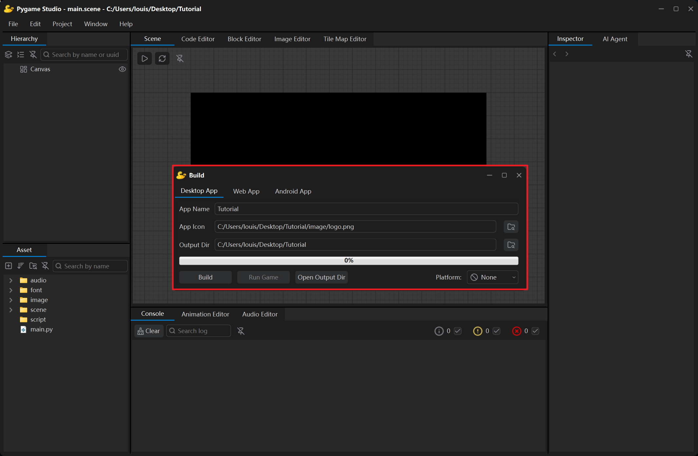
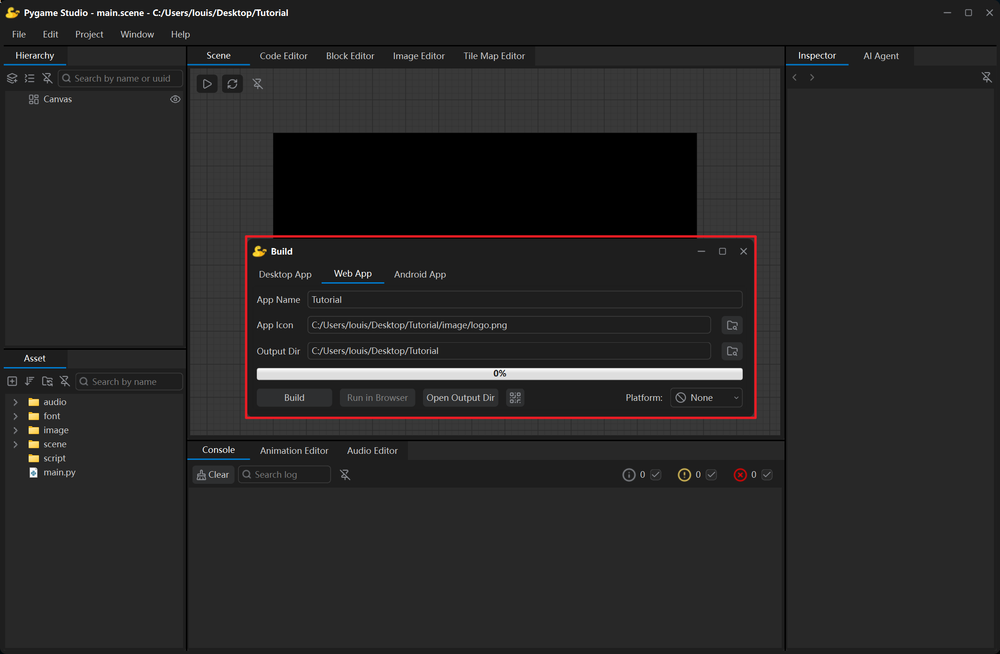
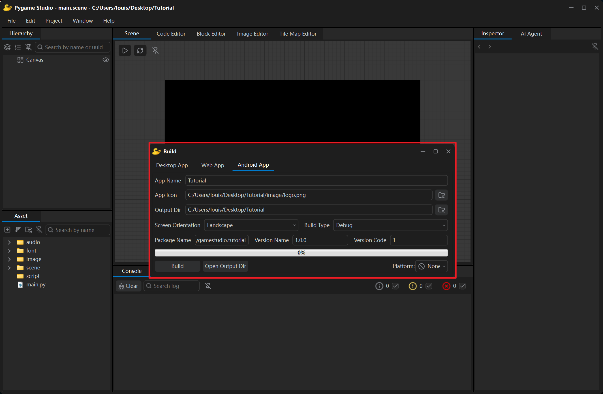

The **Build** window is opened with the **Project → Build** menu. It packages the current project into a standalone desktop app, web app or Android app: it first prepares a protected copy of the project and hands it to `PyInstaller`, `Pyodide` or the Android SDK's own build tools, and the whole run is reported in the [Console](/editor_introduction/console/).



## Targets

A tab bar sits at the top of the window; each tab is one build target:

| Tab | What it produces |
| --- | --- |
| **Desktop App** | A folder with a program that runs on the current operating system (Windows / macOS / Linux). |
| **Web App** | A folder (`index.html` + `game.zip`) that plays the game right in a browser. |
| **Android App** | An `.apk` file that installs on an Android phone or tablet and runs the game there. |

## Packaging a desktop app


| Field | What it does |
| --- | --- |
| **App Name** | Name of the executable and of its folder. Left empty, the project name is used. |
| **App Icon** | Icon of the application; supports `.png`, `.ico` and `.icns`, and defaults to the project's `image/logo.png`. |
| **Output Dir** | Folder that receives the build; defaults to the project folder, and the result is written to its `build/Windows/` subfolder. The final exe can be found in the `build/Windows/dist/{App Name}` folder. |
| **Build** | Starts the build; while it runs the button text turns into **Stop**. |
| **Run Game** | Available after a successful build: starts the built executable as a separate process, so you can try it right away. |
| **Open Output Dir** | Opens the output folder in the file manager. |
| **Platform** | The SDK of the chosen platform is added while building; **TapTap PC** is supported so far. |

These settings are saved in the project and filled in again automatically the next time the Build window is opened. Every build clears the cache and temporary files left behind by the previous build first — no manual cleanup needed.

The whole `dist/<App Name>/` folder (or a zip of it) can be handed to other players. Besides `dist/`, the output folder also holds `_build/`, `_protected` and a `.spec` file — all by-products that can be deleted; the next build recreates them automatically.

```text
<Output Dir>/build/<Operating System>/dist/<App Name>/
├─ <App Name>.exe     the executable
└─ _internal          the dependency files
```

## Packaging a web app



The **Web App** build packs the project into a tiny folder (`index.html` + `game.zip`) that plays right in any modern browser — the player does not need to install anything.

| Field | What it does |
| --- | --- |
| **App Name** | The page title; defaults to the project folder name. |
| **App Icon** | The browser tab icon; defaults to the project's `image/logo.png` and is converted to `favicon.ico` while building. |
| **Output Dir** | Defaults to the project folder; the result is written to its `build/Web/` subfolder. |
| **Build** | Starts the build; while it runs the button text turns into **Stop**. |
| **Run in Browser** | Starts a local server for the output folder and opens the browser automatically. |
| **Scan to Play** | After build, hover over this button to show a QR code. Scan it to try the game on your phone. |
| **Platform** | The SDK of the chosen platform is added while building; **bilibili Toy** is supported so far. |

**Run in Browser** is the quickest way to try a build: the button becomes available once a build has succeeded, starts a small local web server and opens the game page in your default browser.

```text
<Output Dir>/build/Web/
├─ pyodide/        Folder for game runtime dependencies
├─ index.html      the page (opens the game, shows loading state and errors)
├─ game.zip        the protected project + a patched copy of the engine
├─ favicon.ico     the browser tab icon
```

Upload built contents to any static host (GitHub Pages, Netlify, an ordinary web server) to publish the game. Or run it with:

```bash
python -m http.server 8000 --directory "<Output Dir>/build/Web"
```

Then open `http://localhost:8000/` in the browser.

:::note
Double-clicking `index.html` does not work — the browser refuses to read the `game.zip` file directly.
:::

## Packaging an Android app



The **Android App** build turns the project into an `.apk` that installs on an Android phone or tablet and runs there. What makes it different from the other two targets: the Python runtime, pygame-ce and pymunk are **already compiled inside the editor** (the runtime pack that ships with the engine), so the build needs no network access — no Gradle, no Android Gradle Plugin and no NDK either.

### Before the first build: JDK and Android SDK

Open the **Android Build** page of the [Editor Settings](/editor_introduction/editor_settings/) and fill in two paths:

| Field | Meaning |
| --- | --- |
| **JDK** | Folder of a JDK 17 or newer — it contains `bin/java.exe` and `bin/keytool`. |
| **Android SDK** | Folder that contains `platforms/android-34` and `build-tools/`. |

When a path is empty or wrong, pressing Build fails immediately and the Console says which piece is missing. The SDK needs **platform 34** and any **build-tools** version (`aapt2`, `d8`, `zipalign` and `apksigner` live there).

### Fields

| Field | Meaning |
| --- | --- |
| **App Name** | File name of the APK and the name shown in the phone's launcher. |
| **App Icon** | Launcher icon; defaults to the project's `image/logo.png`. Every density plus an Android 8+ adaptive icon is generated while building. |
| **Output Dir** | Defaults to the project folder; the result is written to its `build/Android/` subfolder. |
| **Screen Orientation** | **Landscape** or **Portrait** — both let the player flip the phone 180°. |
| **Package Name** | Like `org.pygamestudio.mygame`: at least two segments, each starting with a lowercase letter. Left empty, it is derived from the app name. |
| **Version Name / Version Code** | `versionName` (e.g. `1.0.0`) and `versionCode` (an integer that has to grow with every store update). |
| **Build Type** | **Debug** or **Release** — see the next section. |
| **Build** | Starts the build; while it runs the button text turns into **Stop**. |
| **Open Output Dir** | Opens the output folder in the file manager. |

These settings are stored in the project's `project.pygs` too and filled in again the next time the window is opened. The result:

```text
<Output Dir>/build/Android/
├─ <App Name>-debug.apk     debug build
└─ <App Name>-release.apk   release build
```

### Debug and release

| | Debug | Release |
| --- | --- | --- |
| Signing | Uses the Android debug certificate | Needs your own keystore |
| Install on a phone to try it out | Yes | Yes |
| Publish to an app store | No | Yes |

Choosing **Release** adds four signing rows to the tab:

| Field | Meaning |
| --- | --- |
| **Keystore** | A `.jks` / `.keystore` file. If you have none yet, press **New...**, fill in an alias and the two passwords and the editor creates one with the JDK's own `keytool`. |
| **Key Alias** | Name of the key pair inside the keystore. |
| **Keystore Password** | Password that opens the keystore. |
| **Key Password** | Password of that key pair — usually the same value. |

The passwords are **not** written into the project: they stay in the editor settings on this machine and are handed to the signing tool through environment variables, so they never show up in the log or on a command line.

:::note
Back up the keystore. Every later update of the same app must be signed with **the same keystore**, otherwise the phone refuses to install over the old version and the store rejects the new APK.
:::

### Installing on a phone

Copy the APK to the phone, or use a cable / `adb`:

```bash
adb install -r "<Output Dir>/build/Android/<App Name>-debug.apk"
```

The APK supports **Android 7.0 (API 24) and newer** and contains `arm64-v8a` only (the architecture of virtually every recent phone).

### What is inside the app

The Python runtime bundled into the APK contains:

- the Python standard library
- pygame-ce (including `pygame.freetype`)
- pymunk and cffi

Projects that only use these build as they are. If the project also `import`s another third-party library (for example `numpy` or `requests`), the build says so — those libraries need their own Android build, which does not ship with the editor yet; more common libraries will be supported over time.

:::tip
Inside a script, `studio.is_android()` tells whether the game runs on a phone — handy for showing touch controls or hiding keyboard hints.
:::

## Build protection and encryption

Before a build, a copy of the project is made; the original project folder is never touched and everything happens in the copy. In the copy all comments and docstrings are removed; then the project's resources (images, audio, fonts, scene files) are encrypted. `project.pygs` and `main.py` stay in plain text.

:::note
The editor is open source, so its encryption and obfuscation algorithm are public — the protection only deters casual copying, nothing more.
:::

## When a build fails

| Log line or dialog | Meaning |
| --- | --- |
| Failed to build the project. Please check the log. | Scroll the Console up to the first line starting with `ERROR:` — the failing step is described there. |
| The build completed but the executable was not found: …/dist | The build finished normally but produced no executable — usually the app name contains characters the file system does not accept. Choose a simple name and build again. |
| Modules that could not be found, skipped: … | A module the game imports is not installed in the Python environment that runs the editor. Install it and build again. |
| The JDK path is empty… | Editor Settings has no JDK path. |
| The JDK path is not a JDK folder (no bin/java.exe) | A JRE or another folder was picked. |
| The JDK is older than 17… | Use JDK 17 or newer. |
| The Android SDK path is empty / is not an SDK folder | No SDK path, or the wrong folder. |
| The Android SDK has no platform 34 | Install Android 14 (API 34) with the SDK Manager. |
| The Android SDK has no build-tools | Install any build-tools version with the SDK Manager. |
| The package name must have two or more lowercase segments… | The package name is invalid. |
| A release build needs a keystore: pick a .jks file first | Build type is Release but no keystore was chosen. |
| The signing key cannot be used: … | Alias or password does not match the keystore. |
| The editor has no Android runtime pack: … | The editor installation is incomplete — reinstall the editor. |