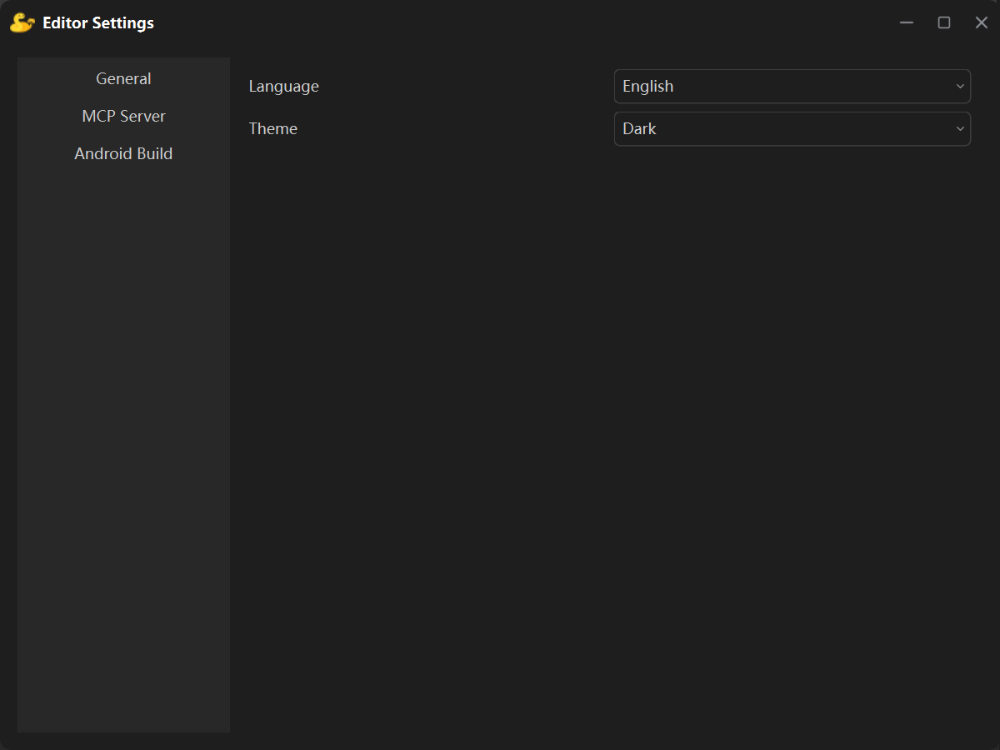
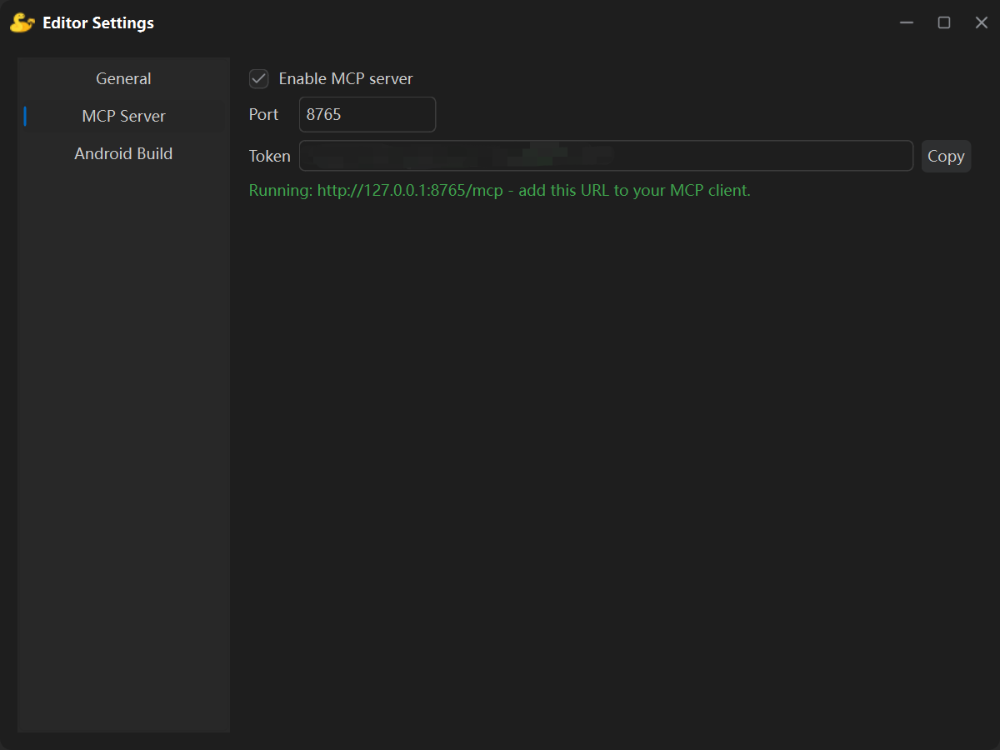
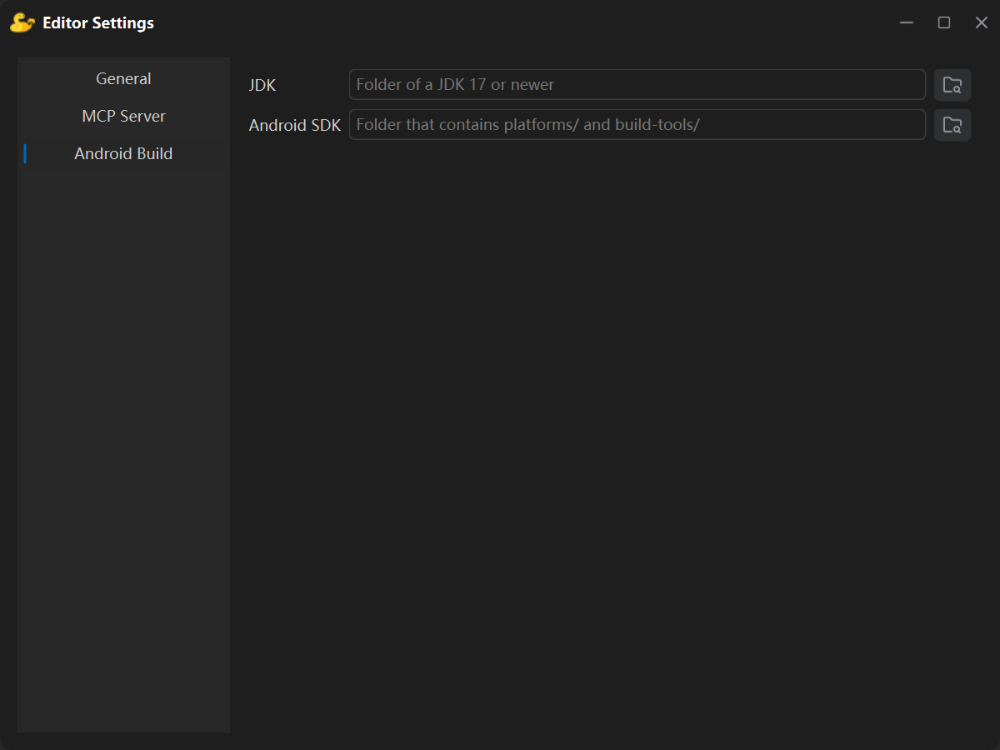

**Editor Settings** is opened from the menu **File → Editor Settings**. Everything on this page belongs to the editor on **this machine** — nothing here is tied to a project.

The list on the left currently has three pages: **General**, **MCP Server** and **Android Build**.

:::note
These options are stored in the editor's own configuration on this machine. They are **not** written into the project and are never shipped with it. Settings that belong to the project are on the [Project Settings](/editor_introduction/project_settings/) page.
:::

## General

| Field | Meaning |
| --- | --- |
| **Language** | Interface language of the editor: English / 中文简体. The switch takes effect immediately — no restart. |
| **Theme** | **Dark** or **Light**. |

## MCP Server

It lets an external AI client (Codex, DeepSeek Harness, …) read and edit the current project through the Model Context Protocol.

| Field | Meaning |
| --- | --- |
| **Enable MCP server** | Starts the server on this machine as soon as it is ticked; unticking stops it. The state is stored, so the next editor start follows the same choice. |
| **Port** | `8765` by default, any value from 1024 to 65535. Changing it while the server runs restarts the server. |
| **Token** | A random string generated by the editor, read-only; the **Copy** button next to it puts it on the clipboard. |
| **Status line** | While running it shows the full address (e.g. `http://127.0.0.1:8765/mcp`) and asks you to paste it into your MCP client. |

:::tip
You can simply tell the AI the port, the token and the URL `http://127.0.0.1:8765/mcp`, and let it drive the Pygame Studio engine to build the game.
:::

## Android Build

This page holds the two paths used by [packaging an Android app](/editor_introduction/build_window/):

| Field | Meaning |
| --- | --- |
| **JDK** | Folder of a JDK 17 or newer — it contains `bin/java.exe` and `bin/keytool`. |
| **Android SDK** | Folder that contains `platforms/android-34` and `build-tools/`. |

- The browse button on the right picks a folder; a pasted path works too.
- **No NDK is needed** — every native library comes from the runtime pack shipped with the editor.
