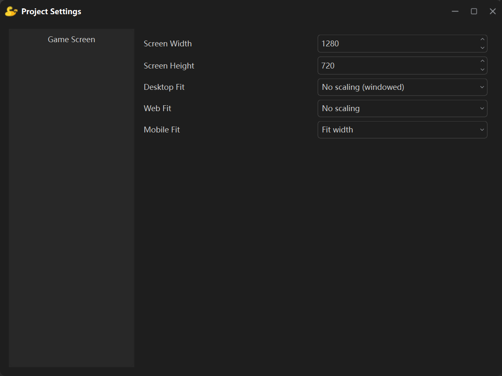

**Project Settings** is opened from the menu **Project → Settings** and sets the size of the game picture and the way it is fitted to the screen.

The list on the left currently has a single page: **Game Screen**.

## Width and height

These two numbers are the **canvas size**, i.e. the design resolution of the game: every object coordinate in the scene lives in that space, and `studio.get_screen()` returns exactly this size.

A new project's canvas is **1280 × 720** by default.

## The three fit settings

One game runs on phones, desktops and browsers, and those screens have very different aspect ratios — so each environment has its own picker:

| Field | Applies to | Default |
| --- | --- | --- |
| **Desktop Fit** | Running the game on the desktop, and desktop builds | No scaling (windowed) |
| **Web Canvas Fit** | Written into the page when the web app is built | No scaling |
| **Mobile Screen Fit** | A phone, after the APK is built and the game runs there | Fit width |

On the desktop every mode except "No scaling (windowed)" makes the game window cover **the whole monitor**, and the picture is then scaled with that mode. "No scaling (windowed)" is the original behaviour: the window is exactly the canvas size and nothing is scaled.

## How the scaling works

The engine draws the game onto a **canvas-sized surface** and scales that surface onto the real screen every frame. The modes only differ in which scale factor they use:

| Mode | Scale factor | Result |
| --- | --- | --- |
| Fit width | screen width ÷ canvas width | The sides touch the screen edges; the height follows the same factor, and whatever does not fit is **cropped evenly** top and bottom (or letterboxed if it is short) |
| Fit height | screen height ÷ canvas height | The top and bottom touch; the width follows the same factor, and the extra is **cropped evenly** left and right (or letterboxed) |
| Stretch to screen | width and height each scale | The picture fills the screen, but its proportions **change** |
| No scaling | 1 | The canvas is drawn at its own size |

For example, a 1280 × 720 canvas on a 1920 × 1080 landscape phone with **Fit width** (factor 1.5):

- the picture becomes 1920 × 1080 and fills the screen exactly.

The same canvas on a 2400 × 1080 screen (20:9) with **Fit width** needs a factor of 1.875, so the height becomes 1350 pixels while the screen has only 1080 — **135 pixels are cropped at the top and at the bottom**. To avoid cropping, pick **Fit height** (which letterboxes the sides instead) or use a canvas whose ratio is closer to the target screen.
