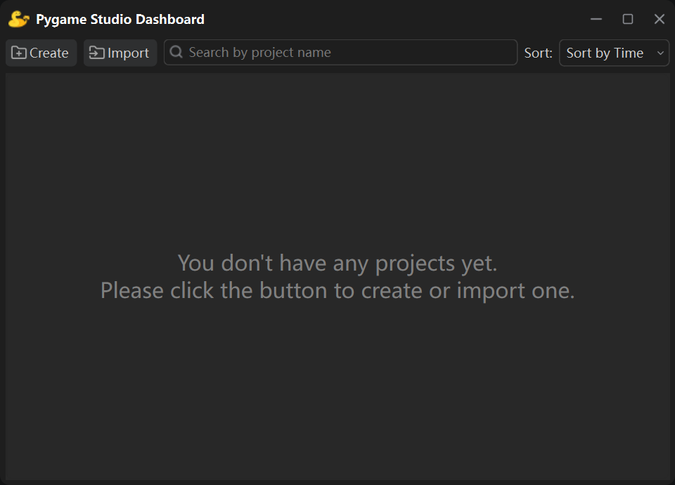

This guide will walk you through installing **Pygame Studio** and verifying the installation on your system.

## Prerequisites
Ensure you have **Python 3.10 or higher** installed on your machine.

You can check your Python version by running this command in your terminal:

```bash
python --version
```

## Install Pygame Studio
Open your **terminal** and run the following **pip command**:

```bash
pip install pygamestudio
```

This command will automatically download and install the latest stable version of Pygame Studio and all required dependencies.

| Name | Version |
|-----|-----|
| pygame-ce | >=2.5.8 |
| PySide6 | >=6.12.0 | 
| platformdirs | >=4.12.4 | 
| numpy | >=2.2.6 | 
| pyinstaller | >=6.22.3 |
| soundfile | >=0.14.0 |
| pymunk | >=7.3.1 |

## Verify the Installation
After installation, run the following command in your terminal:

```bash
pygamestudio
```

Or use the shortcut command:

```bash
pygs
```

If the Pygame Studio editor launches successfully, your installation is complete.



## Next Steps
Once installed, you’re ready to start creating projects with Pygame Studio!