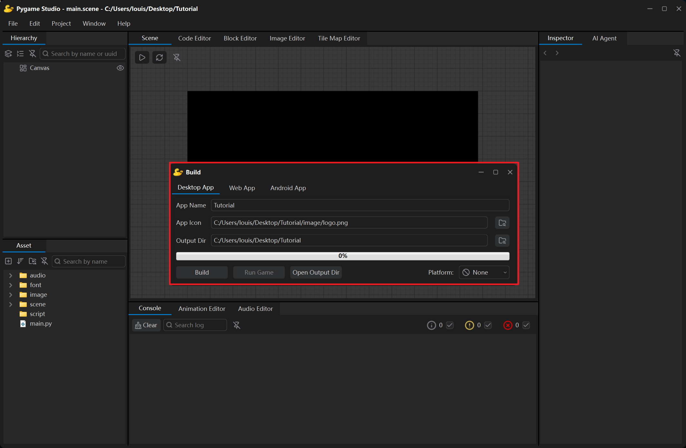
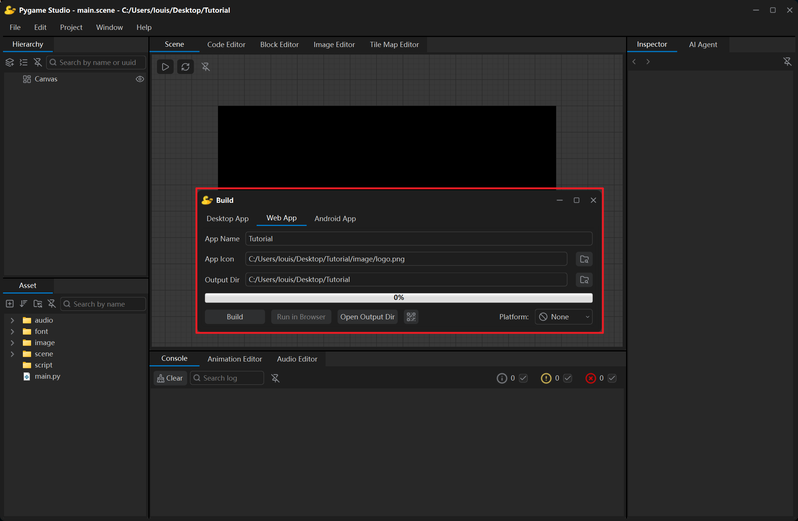
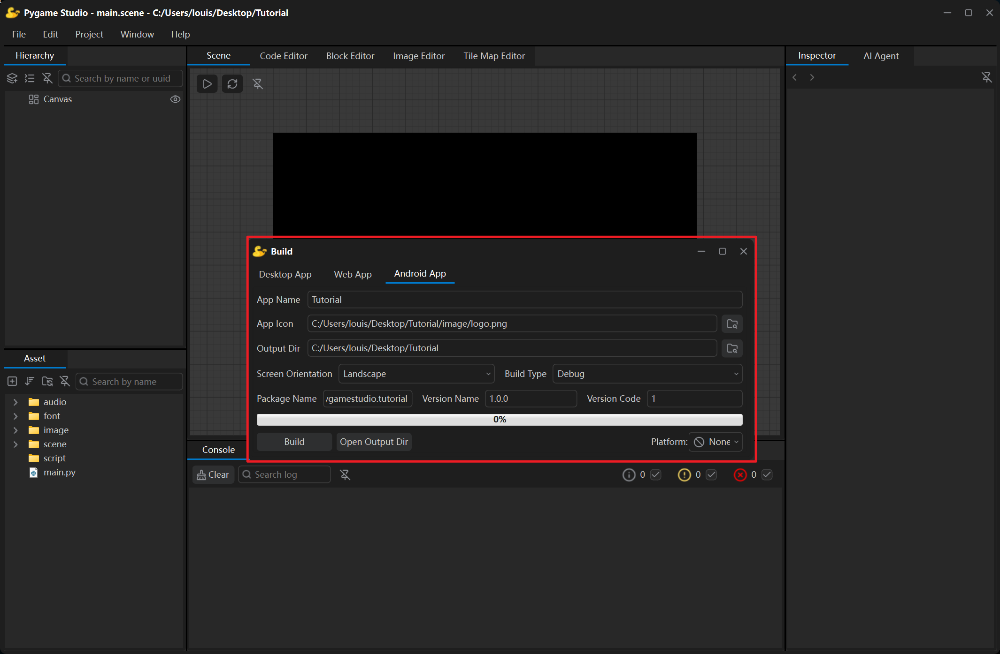

**打包窗口**通过菜单**项目 → 打包**打开，它负责把当前项目工程打包成独立的桌面应用、网页应用或安卓应用：它会先准备一份受保护的项目副本，再交给 `PyInstaller`、`Pyodide` 或 Android SDK 的构建工具打包，整个过程都会输出到[控制台](/zh-cn/editor_introduction/console/)。



## 打包目标

窗口顶部是标签页，每个标签页对应一个打包目标：

| 标签页 | 产出 |
| --- | --- |
| **桌面应用** | 一个文件夹，里面是当前操作系统（Windows / macOS / Linux）可运行的程序。 |
| **网页应用** | 一个文件夹（`index.html` + `game.zip`），在浏览器里直接运行游戏。 |
| **安卓应用** | 一个 `.apk` 文件，可安装到安卓手机或平板上运行游戏。 |

## 桌面应用打包


| 选项 | 说明 |
| --- | --- |
| **应用名称** | 可执行文件及其所在文件夹的名称。留空时使用工程名。 |
| **应用图标** | 应用的图标，支持 `.png`、`.ico`、`.icns`，默认为项目中的 `image/logo.png`。|
| **输出目录** | 存放打包结果的文件夹，默认为项目文件夹，打包结果写入其 `build/Windows/` 子目录。最终的exe可以在`build/Windows/dist/{应用名称}`文件夹中找到 |
| **打包** | 开始打包；打包过程中该按钮文本会变成**停止**。|
| **运行游戏** | 打包成功后可用：以独立进程启动生成的可执行文件，方便立刻试玩。 |
| **打开输出目录** | 在文件管理器中打开输出目录。 |
| **发布平台** | 打包时会添加对应平台的SDK，目前已支持TapTap PC端平台。 |

这些设置会保存在工程里，下次打开打包窗口时会自动填好。每次打包都会先自动清空之前打包留下的缓存与临时文件，无需手动清理。

可把整个 `dist/<应用名称>/` 文件夹（或它的压缩包）发送给其他玩家。除了 `dist/`，输出目录里还有 `_build/`、`_protected`和一个 `.spec` 文件，它们都是中间产物，可以直接删除，下次打包会自动重新生成。

```text
<输出目录>/build/<操作系统>/dist/<应用名称>/
├─ <应用名称>.exe      可执行文件
└─ _internal          依赖文件
```

## 网页应用打包



**网页应用**打包功能可以把工程打包成一个很小的文件夹（`index.html` + `game.zip`），在任何现代浏览器里直接玩，玩家无需安装任何东西。

| 选项 | 说明 |
| --- | --- |
| **应用名称** | 页面标题，默认为项目文件夹名称。 |
| **应用图标** | 浏览器标签页图标，默认为项目中的 `image/logo.png`，打包时会被转换为 `favicon.ico`。 |
| **输出目录** | 默认为项目文件夹，打包结果写入其 `build/Web/` 子目录。 |
| **打包** | 开始打包；打包过程中该按钮文本会变成**停止**。 |
| **在浏览器中运行** | 为输出文件夹启动本地服务器并自动打开浏览器。 |
| **扫码试玩** | 打包后将鼠标移动到该按钮上会显示二维码，扫一扫即可在手机上试玩。 |
| **发布平台** | 打包时会添加对应平台的SDK，目前已支持bilibili Toy平台。 |

**在浏览器中运行**按钮是试玩打包结果最快的方式：打包成功后按钮变为可用，它会启动一个本地小服务器，并在默认浏览器中打开游戏页面。

```text
<输出目录>/build/Web/
├─ pyodide/        存放游戏运行依赖的文件夹
├─ index.html      页面（负责打开游戏、显示加载状态与错误）
├─ game.zip        受保护的工程 + 打过补丁的引擎副本
├─ favicon.ico     浏览器标签图标
```

把打包好的内容上传到任意静态托管（GitHub Pages、Netlify、普通 Web 服务器）即可发布游戏。或者可以通过以下命令运行游戏：

```bash
python -m http.server 8000 --directory "<输出目录>/build/Web"
```

运行命令后在浏览器中打开 `http://localhost:8000/`即可。

:::note
直接双击 `index.html` 是不行的——浏览器不允许直接读取文件 `game.zip`。
:::

## 安卓应用打包



**安卓应用**打包会把工程打成一个 `.apk`，可安装到安卓手机或平板上直接运行。它和另外两个目标最大的区别是：Python 运行时、pygame-ce、pymunk 这些原生库**已经预先编译在编辑器里**（引擎自带的运行时包），所以打包时不需要联网，也不需要 Gradle、Android Gradle 插件或 NDK。

### 准备工作：JDK 与 Android SDK

先在[编辑器设置](/zh-cn/editor_introduction/editor_settings/)的**安卓打包**页填好两个路径：

| 选项 | 说明 |
| --- | --- |
| **JDK** | JDK 17 或更高版本的文件夹，里面有 `bin/java.exe` 与 `bin/keytool`。 |
| **Android SDK** | 包含 `platforms/android-34` 与 `build-tools/` 的文件夹。 |

路径没填或填错时，点打包会立刻失败，并在控制台说明缺的是哪一项。Android SDK 里需要有 **platform 34** 与任意版本的 **build-tools**（`aapt2`、`d8`、`zipalign`、`apksigner` 都在里面）。

### 选项

| 选项 | 说明 |
| --- | --- |
| **应用名称** | APK 的文件名，也是手机启动器里显示的名字。 |
| **应用图标** | 启动器图标，默认为项目中的 `image/logo.png`；打包时会生成各种分辨率的图标，以及 Android 8 以上的自适应图标。 |
| **输出目录** | 默认为项目文件夹，打包结果写入其 `build/Android/` 子目录。 |
| **屏幕方向** | **横屏**或**竖屏**。两者都允许把手机翻转 180° 后继续玩。 |
| **安卓包名** | 形如 `org.pygamestudio.mygame`：至少两段、每段以小写字母开头。留空时按应用名称自动生成。 |
| **版本名 / 版本号** | `versionName`（如 `1.0.0`）与 `versionCode`（整数；每次更新上架都要比上一版大）。 |
| **构建类型** | **调试版**或**发布版**，见下一小节。 |
| **打包** | 开始打包；打包过程中按钮文本会变成**停止**。 |
| **打开输出目录** | 在文件管理器中打开输出目录。 |

这些设置同样保存在工程的 `project.pygs` 里，下次打开打包窗口时自动填好。打包结果：

```text
<输出目录>/build/Android/
├─ <应用名称>-debug.apk     调试版
└─ <应用名称>-release.apk   发布版
```

### 调试版与发布版

| | 调试版 | 发布版 |
| --- | --- | --- |
| 签名 | 自动使用 Android 调试证书 | 需要自己的签名文件 |
| 能否安装到手机上试玩 | 能 | 能 |
| 能否上架应用商店 | 不能 | 能 |

构建类型选**发布版**时，标签页会多出签名相关的四行：

| 选项 | 说明 |
| --- | --- |
| **签名文件** | `.jks` / `.keystore` 文件。还没有就点**新建...**：填入别名与两个密码即可生成（编辑器会调用 JDK 自带的 `keytool`）。 |
| **密钥别名** | 签名文件里那对密钥的名字。 |
| **签名文件密码** | 打开签名文件用的密码。 |
| **密钥密码** | 该别名对应密钥的密码，通常与上一条相同。 |

密码**不会**写进工程文件，只保存在本机的编辑器配置里；签名时通过环境变量交给签名工具，不会出现在日志或命令行中。

:::note
签名文件请自行备份。同一个应用后续更新必须使用**同一个签名文件**，否则手机上无法覆盖安装，应用商店也会拒绝新的 APK。
:::

### 安装到手机

把 APK 拷到手机上安装，或用数据线 / `adb`：

```bash
adb install -r "<输出目录>/build/Android/<应用名称>-debug.apk"
```

APK 支持 **Android 7.0（API 24）及以上**，只包含 `arm64-v8a`（目前绝大多数手机都是这个架构）。

### 包里带了哪些库

APK 内置的 Python 运行时包含：

- Python 标准库
- pygame-ce（含 `pygame.freetype`）
- pymunk 与 cffi

只用这些库的项目可以直接打包。如果项目还 `import` 了别的第三方库（例如 `numpy`、`requests`），打包时会给出提示——这些库需要各自的安卓版本才能使用，目前还没有随编辑器提供，后续将逐渐支持其他常用库。

:::tip
脚本里可以用 `studio.is_android()` 判断自己是否运行在手机上，从而显示虚拟按键、隐藏键盘提示等。
:::


## 打包保护和加密

打包前会复制出一份项目工程副本，原项目目录不会被改动，所有处理都在副本上进行。在副本里会删除全部注释与文档字符串；然后会加密项目资源，被加密的包括图片、音频、字体、场景文件、而`project.pygs` 和 `main.py` 则保持明文。

:::note
由于编辑器采用开源方案，其加密算法均是公开的，安全性仅能起到“防君子不防小人”的作用。
:::

## 打包失败时

| 日志或弹窗 | 含义 |
| --- | --- |
| 项目打包失败，请检查日志。 | 请把控制台向上翻到第一条以 `ERROR:` 开头的日志，那里描述了失败的步骤。 |
| 构建结束但没有找到可执行文件：…/dist | 打包正常结束但没有生成可执行文件，通常是应用名称里包含了文件系统不接受的字符——换一个简单的名称重新打包即可。 |
| 找不到以下模块，已跳过：… | 游戏导入的模块没有安装在运行编辑器的 Python 环境里，安装后重新打包。 |
| JDK 路径没有填写… | 编辑器设置里没有填 JDK 路径。 |
| JDK 路径不是一个 JDK 文件夹（里面没有 bin/java.exe） | 选成了 JRE 或别的目录。 |
| JDK 低于 17，无法编译安卓引导层 | 换用 JDK 17 或更高版本。 |
| Android SDK 路径没有填写 / 不是一个 SDK 文件夹 | 没有填 SDK 路径，或选错了目录。 |
| Android SDK 缺少 platform 34 | 用 SDK Manager 安装 Android 14（API 34）平台。 |
| Android SDK 缺少 build-tools | 用 SDK Manager 安装任意版本的 build-tools。 |
| 包名必须由两段或以上小写字母开头的内容组成… | 包名不合法。 |
| 发布版必须有签名文件：请先选择 .jks 文件 | 构建类型是发布版，但没有选签名文件。 |
| 签名密钥无法使用：… | 别名或密码与签名文件不匹配。 |
| 编辑器内缺少安卓运行时包：… | 编辑器安装不完整，缺少运行时包，需要重新安装编辑器。 |