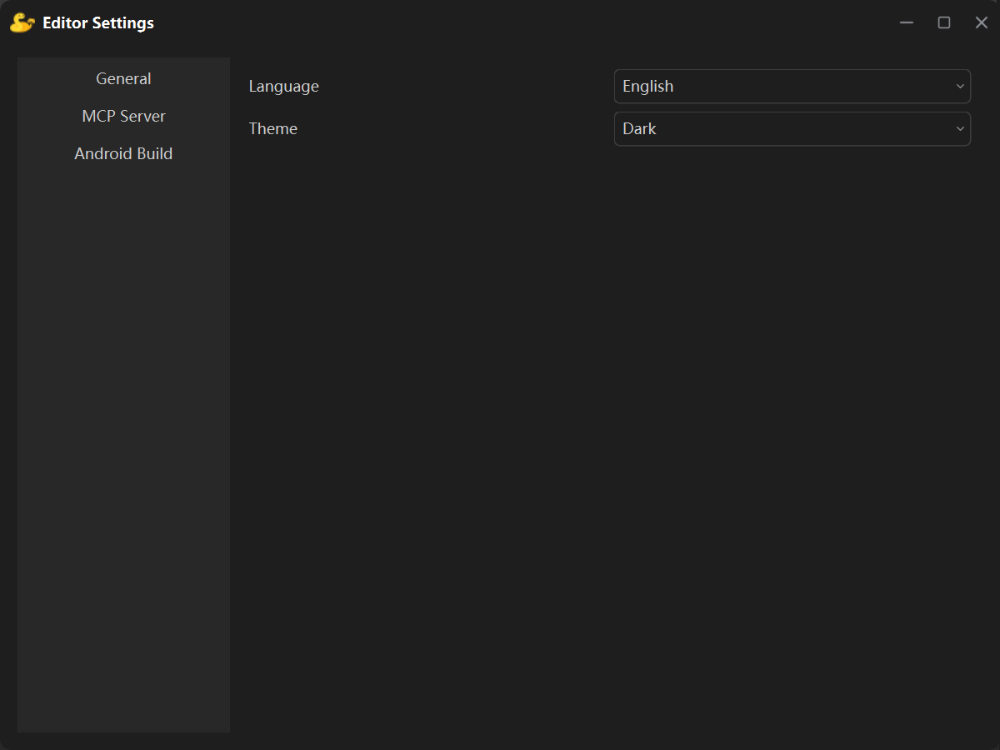
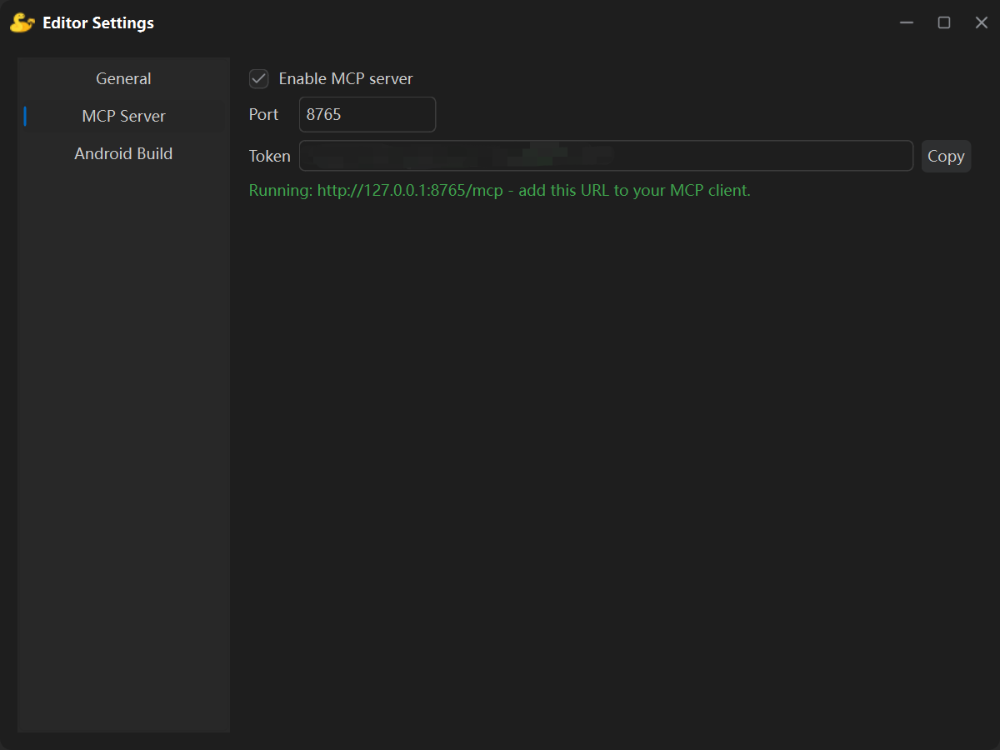
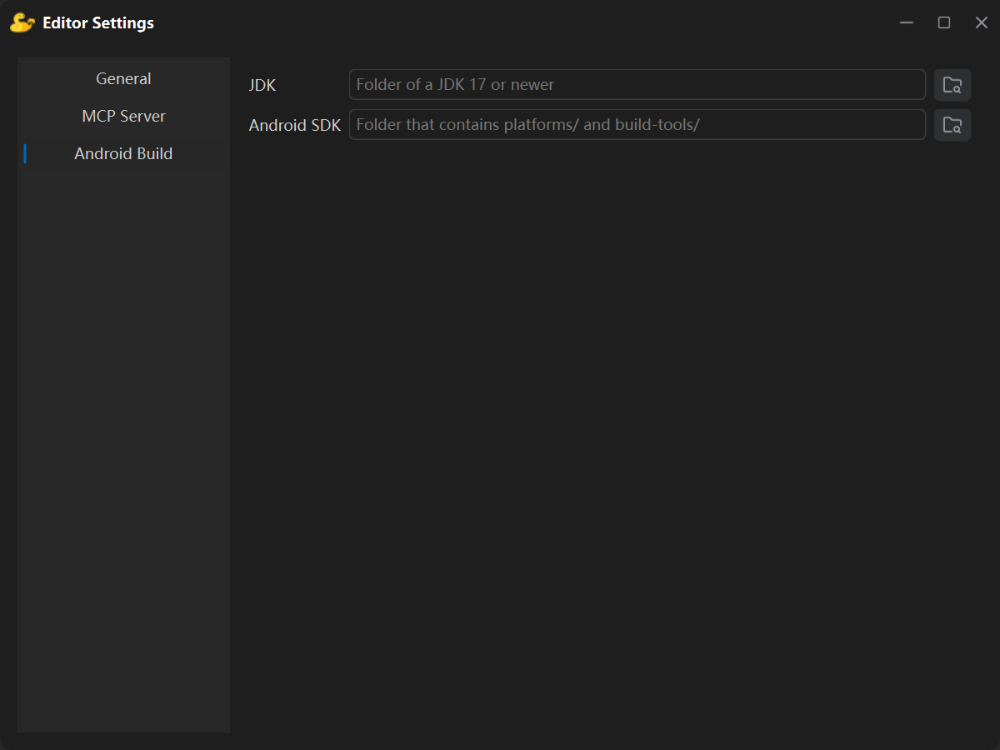

**编辑器设置**通过菜单**文件 → 编辑器设置**打开，它保存的是**这台电脑上编辑器自身**的偏好，与具体工程无关。

窗口左侧列表目前分三页：**通用设置**、**MCP 服务器**、**安卓打包**。

:::note
这里的选项都保存在本机的编辑器配置里，**不会**写进工程，也不会随工程发给别人。工程自身的设置请用[项目设置](/zh-cn/editor_introduction/project_settings/)。
:::

## 通用设置

| 选项 | 说明 |
| --- | --- |
| **语言** | 编辑器界面语言：中文简体 / English。切换后立即生效，不需要重启。 |
| **主题** | **深色**或**浅色**。|

## MCP 服务器

可以让外部 AI 客户端（Codex、Deepseek Harness等）通过 Model Context Protocol 读取并修改当前的工程。

| 选项 | 说明 |
| --- | --- |
| **启用 MCP 服务器** | 勾选后立刻在本机启动服务，取消勾选则停止。状态会记在配置里，下次打开编辑器时按上次的状态自动启动。 |
| **端口** | 默认为 `8765`，可填 1024–65535。服务正在运行时改动会自动重启。 |
| **访问令牌** | 编辑器自动生成的随机字符串，只读；右侧的**复制**按钮可以一键复制。 |
| **状态行** | 服务运行时显示完整地址（如 `http://127.0.0.1:8765/mcp`），并提示把它填进 MCP 客户端。 |

:::tip
开发者可以直接告诉AI端口、访问令牌和访问地址`http://127.0.0.1:8765/mcp`，让它去操控Pygame Studio引擎开发游戏。
:::

## 安卓打包

这一页只有两个路径，供[打包安卓应用](/zh-cn/editor_introduction/build_window/)使用：

| 选项 | 说明 |
| --- | --- |
| **JDK** | JDK 17 或更高版本的文件夹，里面有 `bin/java.exe` 与 `bin/keytool`。 |
| **Android SDK** | 包含 `platforms/android-34` 与 `build-tools/` 的文件夹。 |

- 点右侧的浏览按钮可以选择文件夹；直接粘贴路径也可以；
- **不需要 NDK**——所有原生库都由编辑器自带的运行时包提供。