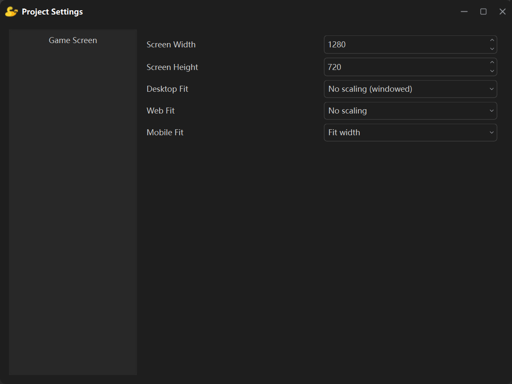

**项目设置**通过菜单**项目 → 设置**打开，用来设置游戏画面的尺寸与适配方式。

左侧列表目前只有**游戏窗口**一页。

## 窗口宽度与高度

这两个数值就是**画布尺寸**，也就是游戏的设计分辨率：场景里所有对象的坐标都落在这个坐标系里，脚本中 `studio.get_screen()` 拿到的也是这个尺寸。

新建工程画布尺寸默认是 **1280 × 720**。

## 三种适配方式

同一个游戏会跑在手机、桌面和浏览器上，而三者的屏幕比例各不相同，所以每个环境都有自己的适配下拉框：

| 选项 | 生效环境 | 默认值 |
| --- | --- | --- |
| **桌面端适配** | 在桌面上运行游戏、以及桌面应用打包后 | 原样显示（窗口模式） |
| **网页端适配** | 打包成网页应用时写入页面 | 原样显示 |
| **移动端适配** | 打包成安卓应用后在手机上运行游戏时 | 按宽度适配 |

桌面端除"原样显示（窗口模式）"以外的三种模式都会把游戏窗口**铺满整个显示器**（全屏），画面再按所选模式缩放；"原样显示（窗口模式）"则是原来的行为——窗口大小等于画布大小，不做任何缩放。

## 缩放是怎么算的

引擎把游戏画在一张**画布大小的表面**上，每帧再把它缩放显示到真实屏幕上。几种模式的区别只是"用哪个缩放比例"：

| 模式 | 使用的缩放比例 | 结果 |
| --- | --- | --- |
| 按宽度适配 | 屏幕宽 ÷ 画布宽 | 左右正好贴边；高度按同一比例得出，多出来的部分**居中裁掉**，不足则上下留黑边 |
| 按高度适配 | 屏幕高 ÷ 画布高 | 上下正好贴边；宽度按同一比例得出，多出来的部分**居中裁掉**，不足则左右留黑边 |
| 拉伸铺满 | 宽、高各自缩放 | 画面正好铺满，但比例会**变形** |
| 原样显示 | 1（不缩放） | 画布多大就画多大 |

举个例子，1280 × 720 的画布放到 1920 × 1080 的横屏手机上（按宽度适配，比例 1.5）：

- 显示尺寸 1920 × 1080，正好铺满，没有裁切。

同一画布放到 2400 × 1080 的屏幕（20:9）上，按宽度适配时比例是 1.875，高度需要 1350 像素，而屏幕只有 1080 —— 于是**上下各裁掉 135 像素**。想避免裁切就改用**按高度适配**（此时左右留黑边），或者把画布改成更接近目标屏幕的比例。